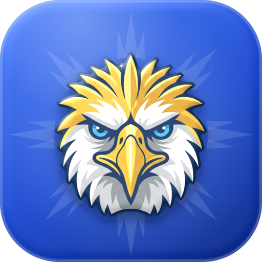

<p align="center">
  
</p>

<h1 align="center">The Eagle's Watch</h1>

<p align="center"><i>Sundan ang bawat piso. Bantayan ang bawat buwis.</i></p>

This is for the best transparency of tax that is earned through the blood and sweat of each citizen of the Philippines. We will keep on guarding from LGUs up to the President using this project.

The app lists public infrastructure projects with their contracts, schedules, reported progress and the documents behind them, so citizens can check what is being built with public money, by whom, and how far along it is. Every figure says how it was established, and every record has a way to report wrong or outdated information.

> **Status: design preview on a sample dataset.** The app runs on ten **fictional** project records, labelled on every screen. Places are real municipalities; the projects, contracts, amounts, people and dates are invented. No live government source is connected yet. The "Rules of public money" under About are real, each with the law it comes from.

## The app

| Screen | What it does |
|---|---|
| **Explore** | Search by title, place, agency, contractor or reference. A status strip and a filter sheet (status, type, level of government, province, implementing agency, contract amount band) with live counts, applied-filter chips, and four sort orders. Each row shows status with its own mark, reported physical progress and its date, the title, type and place, the approved amount and implementing agency, the contract dates, a meter of work reported against contract time used, an evidence line (how the record is supported, how many documents and photos, when it was last checked) and a locator showing where in the country the project sits. |
| **Project page** | Contract and schedule facts, with "Not on file" where a value is missing. Location with coordinates, their precision, and an open-in-maps link. Progress as three separate meters: physical progress as reported, physical progress from an independent check (or "None on file"), and funds disbursed, plus contract time used. A dated timeline mixing agency updates, citizen reports and contract milestones, each with its source. Evidence: site photographs (none in the sample, and nothing shown in their place) and official documents with links or an explicit "Link not on file". Responsible parties as the source lists them. Data provenance: when the record was last checked, its sources, and its revision history. Two report paths: correct the record, or report a problem with the project. |
| **Watchlist** | Projects the citizen follows, as the same rows as Explore. |
| **Updates** | Every dated entry from every record, newest first, each tagged with who reported it. Filter to watched projects. |
| **About** | How to read a record (the four provenance labels and the five status marks), what the project promises, the public sources it plans to connect, the rules of public money, the citizen's own reports, and how to contribute. |
| **Report** | Reachable from every screen. A step-by-step flow, nearly all taps: what is being reported, what happened, who is involved, where and when, optional details, then review. "Report incorrect or outdated information" on a project page starts the flow pre-filled. Reports are anonymous unless the citizen shares contact details, and each gets a reference number listed under About. In the preview they stay on the device. |

Watched projects and reports are saved on the device until accounts and a server exist. Nothing is sent anywhere in the preview.

## How a record is labelled

Every figure carries one of four labels, and the app never implies more than the label says:

| Label | Meaning |
|---|---|
| **Verified** | Checked against an independent source: a site visit, an audit report or a second record. |
| **Agency-reported** | Taken from the implementing or proposing agency's own posting, unchecked. |
| **Community-reported** | Submitted by a citizen through the app, unchecked. |
| **Not available** | Nobody has supplied this information. The record says so instead of guessing. |

Status (planned, ongoing, delayed, suspended, completed), physical progress and funds disbursed are three separate facts and are never substituted for one another. Each status has its own mark (outline, half disc, triangle, square, ticked disc) so it does not depend on colour.

There are no approval ratings, likes or reaction counts: nothing in the app is a number without a source.

## Design system

A restrained, editorial, data-first system for small screens.

- **Colour**: white pages, hairline separators, ink text. The flag's blue is the one action colour (links, primary buttons, selected tabs). Status and provenance colours always travel with a mark or glyph and a label. Gold appears only in the brand mark. Every text colour reads at 4.5:1 or better on its background.
- **Type**: Inter for text, Barlow Condensed for page titles and large figures. Body text is 15sp, nothing a citizen reads is under 12sp, and figures use tabular numerals so columns line up.
- **Shape and depth**: 4dp corners, 1dp borders, no shadows, no pills, no gradients and no illustrations. Imagery is limited to real site photographs with their date, caption and source; where none exist the record says so.
- **Spacing**: a 4dp grid, 16dp gutters on phones and 32dp on wide windows, content capped at a readable width.
- **Controls**: every tap target is at least 44dp, every control has pressed and keyboard-focus states, icon controls carry accessible names, and status is never conveyed by colour alone.
- **States**: loading skeletons (shown only when the wait is long enough to notice), empty states that say what to do, error states with retry, and explicit "Not on file" values.

Tokens live in `ui/Theme.kt`; the components in `ui/Components.kt`; the glyphs, drawn in code so no icon library is needed, in `ui/Icons.kt`; the locator map in `ui/Locator.kt`.

## Tech

[Compose Multiplatform](https://www.jetbrains.com/compose-multiplatform/) with Kotlin. One shared UI in `commonMain`, with thin platform entry points.

| Target | Entry point | Notes |
|---|---|---|
| Android | `composeApp/src/androidMain` | minSdk 24, edge-to-edge |
| iOS | `composeApp/src/iosMain` + `iosApp/` | Needs a Mac with Xcode |
| Web | `composeApp/src/wasmJsMain` | Kotlin/Wasm (Beta in Compose Multiplatform) |

```
composeApp/src/commonMain/kotlin/ph/eagleswatch/
├── App.kt              # layout breakpoint, tabs, and the stack of project pages and reports
├── content/            # Model.kt (records with attribution), SampleData.kt (the labelled fixture), Reports.kt, Content.kt, Day.kt
├── data/               # ProjectRepository: the dataset, load states, and the store the screens read
├── nav/                # top bar, bottom bar, destinations
├── screens/            # Explore, ProjectRow, Project, Report, Watchlist, Updates, About, Common
├── state/              # CitizenState (watchlist, reports), platform storage, share and back
└── ui/                 # theme tokens, components, glyphs, locator map, number formatting
```

`content/SampleData.kt` is the only place sample records live. A live source implements `ProjectRepository` and the screens do not change.

## Run

Requires JDK 17+.

```bash
# Web (Kotlin/Wasm): opens a dev server
./gradlew :composeApp:wasmJsBrowserDevelopmentRun

# Android: needs the Android SDK (ANDROID_HOME)
./gradlew :composeApp:installDebug

# iOS: on a Mac
brew install xcodegen
cd iosApp && xcodegen generate && open iosApp.xcodeproj
```

Production web bundle: `./gradlew :composeApp:wasmJsBrowserDistribution`. The GitHub Actions workflow builds the Android debug APK and the web bundle on every push.

## Licenses

Fonts (Barlow Condensed, Inter) are licensed under the SIL Open Font License 1.1. See [`licenses/`](licenses).
